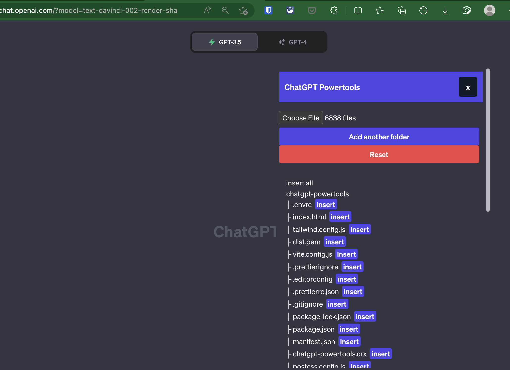

<div align="center">

# ChatGPT Powertools


**Stop pasting files one by one.** Pick a folder and send its files into the chat box.

`MIT` `Chrome` `Unmaintained`

</div>

<br>

A Chrome extension that adds a sidebar to ChatGPT. You choose files or a folder, then insert the ones you want into the message box, each with its path on top. It is an early version: only file and folder upload works so far, and the manifest only matches `chat.openai.com`.

<br>


**1. Download and unzip the build:**

[Download dist.zip](https://github.com/nadimtuhin/chatgpt-powertools/raw/main/dist.zip), then unzip it. You get a `dist` folder.

**2. Load it into Chrome:**

1. Open `chrome://extensions`.
2. Turn on Developer mode.
3. Click "Load unpacked" and choose the `dist` folder.

**3. Heads up:** ChatGPT moved to chatgpt.com and this build only matches chat.openai.com, so the sidebar won't appear until `manifest.json` `matches` is updated and the extension is rebuilt.

Stuck? [How to install Chrome extensions manually from GitHub](https://dev.to/ben/how-to-install-chrome-extensions-manually-from-github-1612).

<br>


**It reads files in your browser.** Nothing is uploaded to a server of ours. The extension reads the files you pick and keeps them in the page.

**Then it types for you.** For each file you insert, it adds `// path/to/file` and the file text to the ChatGPT message box.


<br>


Everything below is the original reference. You don't need it to get started.

## Features

- [x] Upload files and folders
- [ ] Autocomplete prompts
- [ ] Suggest prompts
- [ ] Download conversation
- [ ] Download a response
- [ ] Upload images as base64

## Installation

1. Download [dist.zip](https://github.com/nadimtuhin/chatgpt-powertools/blob/main/dist.zip) from the latest release and unzip it.
2. Go to `chrome://extensions`
3. Enable developer mode
4. Click "Load unpacked" and select the unzipped folder

For detailed steps: https://dev.to/ben/how-to-install-chrome-extensions-manually-from-github-1612

## Development Setup

1. Go to `chrome://extensions`
2. Enable developer mode
3. Click "Load unpacked" and select the `dist` folder
4. Open the ChatGPT website

```bash
yarn install
yarn dev
```

## Screenshots


